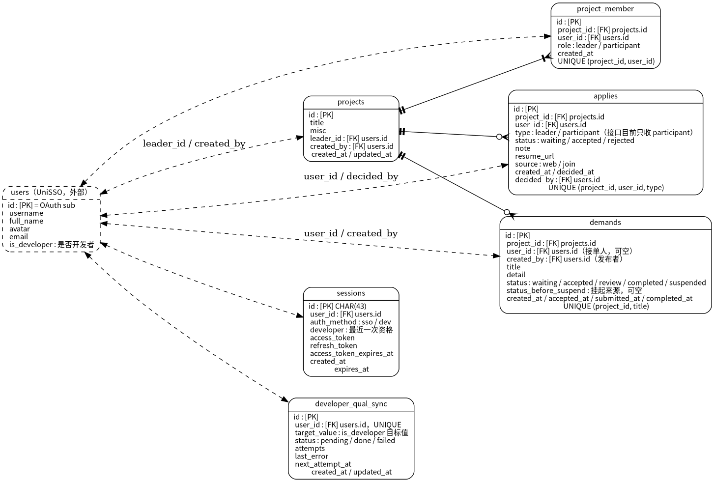

#+title: Developer

Developer —— 一个 sse-market 的项目 / 申请 / 需求撮合平台。

* Architecture

|             | user | participant | leader        | project    | demand         |
|-------------+------+-------------+---------------+------------+----------------|
| user        |      |             |               | apply      |                |
| participant | is   |             |               | apply/quit | release/accept |
| leader      | is   | fire        |               |            |                |
| project     |      |             |               |            |                |
| demand      |      |             |               |            |                |

用户不是本平台的实体：唯一的用户表在 UniSSO 里，本地一律只存 =users.id= （也就是
OAuth 的 =sub= ，36 位字符串）。本库因此只有四张业务表 projects, project_member,
applies, demands，外加两张辅助表 sessions（登录会话）和 developer_qual_sync
（回写 UniSSO 开发者资格的待同步队列）。是不是「开发者」同样不是本平台的字段，
而是 UniSSO =users.is_developer= 的取值。
#+begin_src dot :file ./static/er-clean.png :exports results
  digraph ER_Clean {
    rankdir=LR;
    ranksep=1.8;
    nodesep=0.45;

    node [ shape=Mrecord, fontname="Noto Sans CJK SC", fontsize=11 ];
    edge [ dir=both ];

    users
    [ label="users（UniSSO，外部） |
     id : [PK] = OAuth sub\l
     username\l
     full_name\l
     avatar\l
     email\l
     is_developer : 是否开发者",
      style=dashed ];

    projects
    [ label="projects |
     id : [PK]\l
     title\l
     misc\l
     leader_id : [FK] users.id\l
     created_by : [FK] users.id\l
     created_at / updated_at" ];

    project_member
    [ label="project_member |
     id : [PK]\l
     project_id : [FK] projects.id\l
     user_id : [FK] users.id\l
     role : leader / participant\l
     created_at\l
     UNIQUE (project_id, user_id)" ];

    applies
    [ label="applies |
     id : [PK]\l
     project_id : [FK] projects.id\l
     user_id : [FK] users.id\l
     type : leader / participant\l
     status : waiting / accepted / rejected\l
     note\l
     resume_url\l
     source : web / join\l
     created_at / decided_at\l
     decided_by : [FK] users.id\l
     UNIQUE (project_id, user_id, type)" ];

    demands
    [ label="demands |
     id : [PK]\l
     project_id : [FK] projects.id\l
     user_id : [FK] users.id（接单人，可空） \l
     created_by : [FK] users.id（发布者）\l
     title\l
     detail\l
     status : waiting / accepted / completed\l
     created_at / accepted_at / completed_at" ];

    sessions
    [ label="sessions |
     id : [PK] CHAR(43)\l
     user_id : [FK] users.id\l
     access_token\l
     access_token_expires_at\l
     expires_at" ];

    developer_qual_sync
    [ label="developer_qual_sync |
     id : [PK]\l
     user_id : [FK] users.id，UNIQUE\l
     target_value : is_developer 目标值\l
     status : pending / done / failed\l
     attempts\l
     next_attempt_at" ];

    users -> projects [style=dashed, label="leader_id / created_by"];
    users -> project_member [style=dashed];
    users -> applies [style=dashed, label="user_id / decided_by"];
    users -> demands [style=dashed, label="user_id / created_by"];
    users -> sessions [style=dashed];
    users -> developer_qual_sync [style=dashed];

    projects -> project_member [arrowtail=teetee, arrowhead=crowtee];
    projects -> applies [arrowtail=teetee, arrowhead=crowodot];
    projects -> demands [arrowtail=teetee, arrowhead=crowodot];
  }
#+end_src

#+RESULTS:

* 运行

前后端同仓： =server/= 是 Express + MySQL 的 API， =web/= 是 React + Vite 前端。
后端在 8080 上同时提供 =/api= 和前端构建产物，因此只需要一个进程。

** 后端

#+begin_src sh
  cd server
  cp .env.example .env      # 填 MYSQL_* 等
  npm install
  npm run migrate           # 建表；SEED=1 时顺便造演示数据
  npm start                 # 0.0.0.0:8080
#+end_src

=migrate= 只建缺失的表，不改已有表结构。从「本地有 developers 表」的旧库升级没有迁移
脚本（用户实体已搬到 UniSSO），旧库直接丢掉重建即可。

** 前端

#+begin_src sh
  cd web
  npm install
  npm run build             # 产物给后端托管
  npm run dev               # 或开发模式 5173，/api 代理到 8080
#+end_src

** 登录

=auth= 走 UniSSO（ =https://sso.ssemarket.cn= ，授权码 + PKCE）。配置 =SSO_CLIENT_ID= /
=SSO_CLIENT_SECRET= / =SSO_REDIRECT_URI= 后即可用真实身份登录。
未配置时若 =DEV_LOGIN=1= ， =/login= 页面会列出演示开发者供点击登录，便于本地联调。

登录后平台用会话保存的 access token 调 =/api/oauth/userinfo= ，只有 =developer === true=
才放行项目、申请、需求等业务接口；不带该字段、为 false 或类型不对一律拒绝。结果按
=SSO_DEVELOPER_TTL_SECONDS= （默认 60 秒）缓存，可按需调低或设为 0 关闭缓存。

- 未获资格：业务接口返回 =403 NOT_DEVELOPER= ，前端展示认证引导页；
- 身份服务不可用：返回 =503 SSO_UNAVAILABLE= ，本地会话保留；
- access token 失效：清除会话并返回 =401 SSO_SESSION_EXPIRED= ，需重新登录。

=DEV_LOGIN= 会话不查 SSO，直接视为有资格；=GET /api/auth/me= 会带 =developer= 与
=qualification= （ =ok= / =none= / =unknown= ）供前端判断。

** 用户目录

名字、头像、邮箱都来自 UniSSO，本平台只有一份展示缓存，不存身份。两个来源：

1. =POST ${SSO_ISSUER}/api/oauth/users/list= （Basic 认证，复用 =SSO_CLIENT_ID= /
   =SSO_CLIENT_SECRET= ）——一次拿全量。它要求应用在 UniSSO 侧是 =kind=internal= 且启用
   M2M（或在 =UNISSO_PASSWORD_VERIFY_CLIENTS= 里），否则返回 =403 password_verify_forbidden= 。
   没有分页也没有单查，所以结果缓存在进程内：惰性拉取（启动不预取、无定时刷新）、
   =SSO_DIRECTORY_TTL_SECONDS= （默认 60，0 表示不缓存）内复用、并发请求共享同一次拉取。
2. =user_profile= 表 —— 登录回调拿到 =userinfo= 后抄一份 =name/avatar/email= 落库
   （=server/src/directory.js= 的 =remember()= ，写失败只记日志不影响登录）。

取名顺序是：目录命中 → =user_profile= 回落 → 都没有就是 =null= ，前端显示「未知用户」，
接口带 =directoryStale: true= 提示。业务不因此失败。列表 =/api/users= 是「目录 ∪ user_profile」，
所以只要登录过一次，名字就一定找得到；从没登录过的人要靠目录接口有权限。

只从缓存拿到资料的人 =developer= 返回 =null= （未知），页面显示「资格未知」。

=DEV_LOGIN= 打开时目录换成 =server/src/demo-users.js= 里的演示身份，不访问 SSO。

资格写入（Join 方向）：申请通过时写 =is_developer=true= ；被 leader 开除、退出项目或释放项目后，
若已不属于任何项目则写 =false= 。写入失败不阻塞业务，落在 =developer_qual_sync= 表由后台按
=QUAL_SYNC_INTERVAL_MS= 重试同一目标值（指数退避，最多 20 次；=400/401/403/404= 视为终态）。
写入复用 =SSO_CLIENT_ID= / =SSO_CLIENT_SECRET= ，平台侧需把本应用加入
=UNISSO_DEVELOPER_WRITE_CLIENTS= 并开启 =m2m_enabled= ；未配置凭证时写入暂停，业务不受影响。

注意：线上 SSO 需部署返回 =developer= 的版本（unisso 提交 =f2d9e9c= 及以后）。旧版本会让真实账号
全部落在 403，=DEV_LOGIN= 不受影响；升级前创建的会话没有 access token，需要重新登录。

** join 平台接入

join 平台（ =https://join.ssemarket.cn= ）的后端调用 =POST /api/join/applies= ，替用户
提交 participant 申请。该接口不走 UniSSO 会话，用共享密钥 =JOIN_API_KEY= 鉴权：

#+begin_src sh
  curl -X POST "$PUBLIC_URL/api/join/applies" \
    -H "Authorization: Bearer $JOIN_API_KEY" \
    -H 'Content-Type: application/json' \
    -d '{
      "ssoSub": "<UniSSO sub>",
      "projectId": 1,
      "resumeUrl": "https://oss.example.com/resume/xxx.pdf",
      "note": "可选"
    }'
#+end_src

也可以把密钥放在 =X-Api-Key= 头里。请求字段：

- =ssoSub= （必填）：用户在 UniSSO 的 =users.id= （也就是 OAuth sub），本地直接存进
  =applies.user_id= ；
- =projectId= （必填）：本平台 =projects.id= ；
- =resumeUrl= （必填）：http/https 简历地址，审批时由前端直接下载；
- =note= （可选）：不超过 500 字。

姓名、邮箱不在请求里传：它们由目录缓存补全（见上节）。目录里查不到这个 sub 时返回
=404 USER_NOT_FOUND= ；目录暂时不可用时放行，只按 id 记录申请。

返回：新建申请 =201= ，已存在的等待中申请 =200= 且 =duplicate=true= ，已通过的申请 =200= 且
=status: accepted= 、 =duplicate=true= ，被拒后重新提交 =200= 且 =reopened=true= ，已是成员 =409= 。
申请进入现有的待审列表，leader 在项目页或「我的」页面通过 / 拒绝；通过后写入
=project_member= ，简历链接会显示在申请箱里。

=JOIN_API_KEY= 留空时该组接口一律返回 =503= 。
